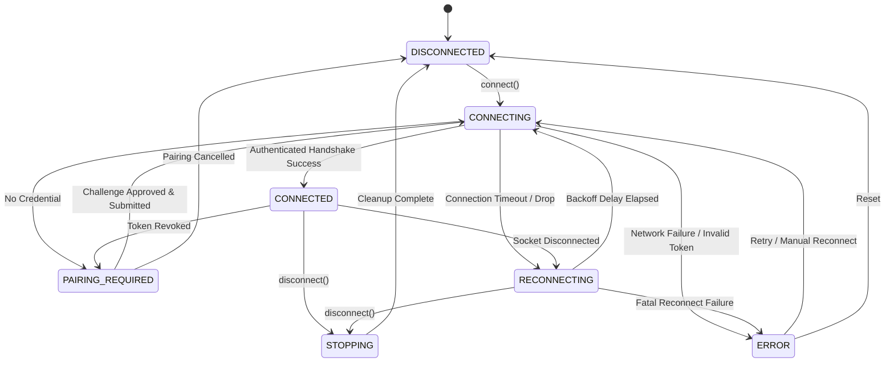

# MUJCODE Local Compiler — Secure Networking & Device Pairing Protocol (Step 3A)

## 1. Architectural Overview

The **MUJCODE Local Compiler Desktop Agent** features an outbound-only networking architecture designed to connect the student's personal computer to the MUJCODE execution ecosystem without exposing any inbound listening ports, local HTTP servers, or opening attack surfaces on the student's local network.

```
┌────────────────────────────────────────────────────────────────────────┐
│                        MUJCODE Web Ecosystem                           │
│                                                                        │
│   [Student Browser]                                [MUJCODE Backend]   │
│   (Logged in on Web)                               (Socket.IO Server)  │
│          │                                                  ▲          │
│          │ 1. Request Pairing Challenge                     │          │
│          ▼                                                  │          │
│   Display Pairing Code (e.g. "PAIR-7K8M9X")                 │          │
└──────────┼──────────────────────────────────────────────────┼──────────┘
           │                                                  │ Outbound TLS
           │ Student Enters Pairing Code                      │ (WSS / HTTPS)
           ▼                                                  │
┌─────────────────────────────────────────────────────────────┼──────────┐
│             MUJCODE Local Compiler (Desktop Agent)          │          │
│                                                             │          │
│   [Renderer UI (HTML/CSS)]                                  │          │
│          │ IPC (Strictly Sanitized, contextIsolated)        │          │
│          ▼                                                  │          │
│   [Main Process Services]                                   │          │
│   ├── AgentConnectionService ◄──────────────────────────────┘          │
│   │     ├── AgentStateMachine (DISCONNECTED ↔ CONNECTED)               │
│   │     ├── SocketIoTransport / MockTransport                          │
│   │     └── Heartbeat & Backoff Watchdogs                              │
│   ├── PairingService                                                   │
│   │     └── CredentialStorage (Electron safeStorage encrypted)         │
│   └── JobProtocol (Validator & Dispatcher)                             │
│         └── CompilerBridge (executeCode - C, C++, Java, Py, JS, SQL)   │
└────────────────────────────────────────────────────────────────────────┘
```

---

## 2. Protocol & Transport Decision

### Transport Selection: Socket.IO Client (over WSS)
- **Compatibility:** The MUJCODE platform ecosystem utilizes Socket.IO for real-time bi-directional messaging, heartbeats, and event routing.
- **Outbound Only:** The agent connects outwards to `wss://api.mujcode.com/agent` (production) or `ws://localhost:5000/agent` (development).
- **TLS Hardening:** In production mode, the transport enforces valid TLS certificates with `rejectUnauthorized: true`. Insecure protocols (`http://` or `ws://`) are strictly rejected by the configuration validator.
- **Pluggable Architecture:** Transport logic is isolated behind `ITransport`, allowing unit and integration tests to run with microsecond precision using `MockTransport` without starting live network servers.

---

## 3. Configuration Management (`AgentConfig`)

Configuration is validated via `validateAgentConfig(config)` on startup and cannot be overridden by renderer IPC:

| Parameter | Default (Prod) | Default (Dev) | Description |
| :--- | :--- | :--- | :--- |
| `backendUrl` | `https://api.mujcode.com` | `http://localhost:5000` | Backend gateway root URL |
| `wsEndpoint` | `wss://api.mujcode.com/agent`| `ws://localhost:5000/agent`| Outbound socket connection endpoint |
| `environment` | `production` | `development` | Environment mode |
| `connectTimeoutMs` | `10000` (10s) | `5000` (5s) | Connection handshake deadline |
| `heartbeatIntervalMs`| `25000` (25s) | `10000` (10s) | Agent ping/heartbeat frequency |
| `heartbeatTimeoutMs` | `60000` (60s) | `30000` (30s) | Stale connection disconnection threshold |
| `reconnectMinDelayMs`| `1000` (1s) | `500` (0.5s) | Initial backoff delay |
| `reconnectMaxDelayMs`| `30000` (30s) | `5000` (5s) | Maximum reconnection backoff cap |
| `reconnectJitter` | `0.2` (20%) | `0.1` (10%) | Randomization factor to prevent stampedes |
| `maxMessageSizeBytes`| `262144` (256 KB) | `262144` (256 KB) | Enforced maximum socket payload size |
| `maxPendingJobs` | `5` | `3` | Max concurrency queue depth |
| `agentVersion` | `1.0.0` | `1.0.0` | Client protocol handshake version |

### Production Security Invariants:
- If `environment === 'production'`, `backendUrl` must begin with `https://` and `wsEndpoint` must begin with `wss://`. Any attempt to configure insecure URLs throws a fatal validation error.
- Setting `rejectUnauthorized: false` or attempting to bypass certificate checking is strictly prohibited in code.

---

## 4. Connection State Machine (`AgentState`)

The agent implements a finite state machine with strict legal transition rules:



### Transition Enforcement:
Any illegal state transition (e.g., `DISCONNECTED -> CONNECTED` without passing through `CONNECTING` and authentication) throws an error and resets to `ERROR`. The UI will **never** display `CONNECTED` unless the socket transport is active and the server has accepted the device credential.

---

## 5. Device Pairing Lifecycle (`PairingService`)

To pair an agent without exposing passwords or long-lived master tokens to the student's local desktop:

1. **Challenge Generation (Web):** The authenticated student clicks "Pair Local Compiler" on the MUJCODE website. The backend generates an unpredictable, single-use 6–32 character challenge code (e.g., `PAIR-8K3N7Q`) with a 5-minute expiry.
2. **Student Consent (Desktop):** The student enters the code into the Local Compiler desktop app and explicitly clicks "Approve & Pair Device".
3. **Challenge Submission:** The agent transmits `agent:pair:request` containing `{ challengeCode, deviceName, agentVersion }`.
4. **Server Verification:** The backend verifies the code against the student's active web session, associates the device ID with the student account, and returns `agent:pair:success` containing a scoped, revocable `deviceToken`.
5. **Secure Storage:** The desktop agent encrypts and persists the credential using Electron's `safeStorage`.
6. **Unpairing:** When the student clicks "Unpair Device", the agent emits `agent:unpair:request` to notify the server, deletes the encrypted credential, and disconnects to `DISCONNECTED`.

---

## 6. Credential Storage & Electron `safeStorage`

- **Hardware/OS-Backed Encryption:** On Windows, Electron's `safeStorage` encrypts data using DPAPI (Data Protection API), tying credential decryption to the local user account.
- **Fail-Closed in Production:** If `safeStorage.isEncryptionAvailable()` returns `false` in production mode, the agent refuses to persist credentials in plaintext and logs a security limitation.
- **Isolation from Renderer:** The `deviceToken` and raw credentials are stored and processed strictly within the Main process. The Preload bridge and Renderer UI are only provided with sanitized metadata (`paired: true`, `deviceId: "..."`, `deviceName: "..."`).

---

## 7. Validated Execution-Job Protocol (`JobProtocol`)

Incoming execution jobs from the MUJCODE server are subjected to rigorous pre-flight validation before touching the compiler bridge:

### Inbound Message: `job:dispatch`
```typescript
interface JobDispatchMessage {
  protocolVersion: '1.0.0';
  jobId: string;             // UUID or alphanumeric (e.g., "job-8f92a4")
  languageId: number;        // Allowed: 50 (C), 54 (C++), 62 (Java), 71 (Python), 63 (JS), 60 (Go), 82 (SQL)
  sourceCode: string;        // Max 100 KB
  stdin?: string;            // Max 1 MB
  timeLimitMs?: number;      // Bounded: 500ms to 15,000ms
  memoryLimitMb?: number;    // Bounded: 16MB to 512MB
  timestamp: number;         // Unix epoch in milliseconds
  expiresAt?: number;        // Job expiry epoch
}
```

### Protocol Validation Gates:
1. **Message Integrity:** Schema checks verify required fields and types.
2. **Language Allowlist:** Only registered language IDs (`50, 54, 62, 71, 63, 60, 82`) are accepted.
3. **Payload Size Caps:** Source code is capped at 100 KB; stdin is capped at 1 MB. Oversized payloads are rejected before parsing.
4. **Expiry Verification:** Jobs received past their `expiresAt` deadline or older than 60 seconds are discarded immediately with `EXPIRED`.
5. **Duplicate / Replay Cache:** A bounded in-memory LRU ring cache stores recent `jobId`s. Replayed messages are rejected with `DUPLICATE_JOB`.
6. **No Arbitrary Commands:** The message schema **does not contain** executable paths, CLI arguments, shell flags, or environment overrides. All execution paths and compiler flags are fixed inside the local language adapters.

### Outbound Result: `job:result`
```typescript
interface JobResultMessage {
  protocolVersion: '1.0.0';
  jobId: string;
  status: 'SUCCESS' | 'COMPILATION_ERROR' | 'RUNTIME_ERROR' | 'TIME_LIMIT_EXCEEDED' | 'DEPENDENCY_MISSING' | 'REJECTED';
  stdout: string;
  stderr: string;
  compilationOutput?: string;
  executionTimeMs: number;
  memoryUsageBytes?: number;
  errorMessage?: string;
  agentVersion: string;
}
```

---

## 8. Implemented Backend Gateway & API Contracts (Step 3B)

The backend agent gateway, device pairing APIs, and job router are implemented in `backend/src/`:
- Services: `AgentDeviceService.js`, `AgentJobRouter.js`
- Sockets: `agentGateway.js` (`/agent` namespace)
- HTTP Endpoints: `routes/agent.js` (mounted under `/api/agent/*`)
- Job Routing: `routes/judge.js` (in `handleSubmission`)

### 1. HTTP REST Endpoints

| Endpoint | Method | Auth | Description |
| :--- | :---: | :---: | :--- |
| `/api/agent/challenge` | `POST` | `requireAuth` | Generates 5-minute, single-use pairing challenge (`PAIR-XXXXXX`). Rate limited (5/5m). |
| `/api/agent/devices` | `GET` | `requireAuth` | Returns student's paired devices with live `isOnline` status. No secret credentials exposed. |
| `/api/agent/devices/:id` | `DELETE` | `requireAuth` | Revokes device owned by student and terminates active socket connection immediately. |
| `/api/agent/status` | `GET` | `requireAuth` | Quick status check for ProblemSolver toolbar (`hasPairedDevice`, `isOnline`, `activeDevice`). |

### 2. Socket.IO Gateway: `/agent` Namespace

#### Authentication Handshake
```typescript
const agentNs = io.of('/agent');

agentNs.use(async (socket, next) => {
  const token = socket.handshake.auth?.token;
  if (token) {
    const device = await AgentDeviceService.authenticateDevice(token);
    if (!device) return next(new Error('DEVICE_AUTHENTICATION_FAILED'));
    socket.device = device;
    socket.deviceId = device.deviceId;
    socket.userId = device.userId;
    socket.isAuthenticatedDevice = true;
    return next();
  }
  // Allow unauthenticated connection strictly for pairing challenge redemption
  socket.isPairingSocket = true;
  next();
});
```

#### Event Contract:
- `pairing:request`: Emitted by unauthenticated agent with `{ challengeCode, deviceId, deviceName, agentVersion }`. Server verifies code and emits `pairing:response` with `{ success: true, deviceToken, userId, userDisplayName }`.
- `heartbeat`: Emitted periodically by authenticated agent with `{ protocolVersion, deviceId, agentVersion, timestamp, compilers }`. Server updates `lastSeenAt` and replies with `heartbeat:ack`.
- `pairing:revoke`: Emitted when agent unpairs. Server marks device revoked in persistent store and disconnects socket.
- `job:dispatch`: Emitted by server to agent with validated `{ protocolVersion, jobId, languageId, sourceCode, stdin, timeLimitMs, timestamp, expiresAt }`.
- `job:result`: Emitted by agent to server with `{ protocolVersion, jobId, status, verdict, stdout, stderr, exitCode, executionTimeMs }`.

### 3. Run vs. Submit Boundaries & Fallback Policy
- **Run Mode (`mode: 'run'`):** When the student has an active connected local agent and `useLocalAgent !== false`, the backend routes execution to the local desktop compiler via `AgentJobRouter.dispatchRunJob`. If the local agent times out (25s) or encounters an error, the backend safely falls back to the cloud judge (`Judge0Service`/`CodeExecutionService`).
- **Submit Mode (`mode: 'submit'`):** Final grading **always** routes to the authoritative, trusted cloud judge and evaluates against hidden test cases. Local agents are never sent hidden test data and their results are never accepted as authoritative submission verdicts.

---

## 9. Security Assumptions & Sandboxing Reality

> [!CAUTION]
> **Operating System Sandboxing Boundary:**
> 1. The desktop agent executes student programs using local child processes with the privileges of the active Windows user.
> 2. The networking layer guarantees message integrity, TLS encryption, authentication, size limits, and sanitization. However, it does **not** provide a kernel-level hardware virtualization sandbox.
> 3. Process execution includes process-tree cleanup (`taskkill /T /F`), resource timeouts, and bounded stdout/stderr buffers, but malicious student code could attempt local filesystem access or network sockets if left unrestricted.
> 4. In a future phase, Windows Job Objects, restricted token sandboxes, or containerized execution should be evaluated before executing untrusted external student code.
